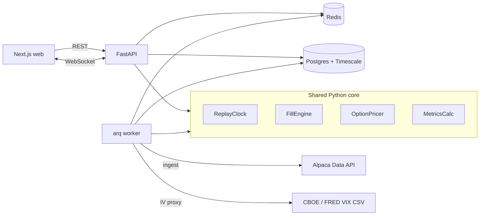

# TapeDeck

TapeDeck is a market replay and paper-trading simulator. It plays historical SPY and QQQ sessions **bar by bar**, lets you trade stocks and options against that tape, then runs the same strategies through a backtester that uses **the same fill engine**.

Tagline: *Rewind the market. Trade it again.*

It is **paper trading only**. There is no live brokerage connection, no real orders, and no bid/ask tape. Fills are modeled from 1-minute OHLC plus slippage because free historical data does not include quotes.

**Live demo:** [http://144.24.11.224:3000](http://144.24.11.224:3000)

## Contents

- [Features](#features)
- [Built-in strategies](#built-in-strategies)
- [Architecture](#architecture)
- [Setup](#setup)
- [Configuration](#configuration)
- [Development](#development)
- [Limitations](#limitations)

## Features

- **Server-side replay clock.** The client only sends play, pause, speed, step, and seek. The API holds the cursor so the browser cannot look ahead.
- **Next-bar fills.** An order submitted on the 10:00 bar fills against a later bar, never the bar you decided on.
- **Shared fill engine.** Paper trading and backtests go through one `FillEngine` (market / limit / stop / bracket, slippage, commissions, buying power, option multiplier).
- **Hybrid option prices.** Real Alpaca option bars when they exist (about Feb 2024 onward); otherwise Black–Scholes with VIX (SPY) or VXN (QQQ) as an IV proxy. Every quote is tagged `real` or `model`.
- **Intraday chart.** TradingView Lightweight Charts with session VWAP, EMA 20, fill markers, and 1m / 5m / 15m buckets built only from revealed minutes.
- **Option chain.** Strikes around spot, 0DTE through ~30 DTE, Greeks, click-to-ticket.
- **Backtests with live progress.** Strategies expose a Pydantic parameter schema; the UI builds the form. Jobs run on an `arq` worker and stream progress over WebSocket.
- **Analytics.** Equity curve, underwater drawdown, Sharpe / Sortino, win rate, profit factor, time-of-day and weekday breakdowns, P&L heatmap, trade list.
- **Journal.** Notes and tags, optional chart screenshot at the cursor (press `J` on replay).
- **Synthetic data.** The app runs with no Alpaca keys. A seeded generator writes SPY/QQQ minutes tagged `source=synthetic` and never overwrites real bars.

### Replay shortcuts

| Key | Action |
|---|---|
| Space | Play / pause |
| → / Shift+→ | Step 1 / 5 bars |
| ↑ / ↓ | Faster / slower |
| N | Next trading day |
| B / S | Market buy / sell |
| F | Flatten |
| 1 / 5 / 0 | 1m / 5m / 15m candles |
| J | Snapshot chart to journal |

## Built-in strategies

| Name | What it does |
|---|---|
| Opening range breakout | Trades the first close outside the opening range, with a range-multiple target |
| VWAP reversion | Fades stretches away from session VWAP |
| Moving average crossover | Fast SMA vs slow SMA; shorts optional |
| 0DTE long straddle | Buys ATM call + put, exits on a percent of debit or before the close |
| 0DTE short iron condor | Sells OTM wings, manages on credit percent / multiple |

Each strategy is a Python class with `on_bar(ctx)`. `Context` can see history only through the current bar.

## Architecture



Replay ticks, fills, and P&L are published on Redis pub/sub. The API process holds live `ReplayManager` runtimes — run **one** API replica.

```
apps/api/app/core/        clock, fill engine, pricer, metrics, strategies
apps/api/app/data/        Alpaca, IV CSVs, synthetic seed, Timescale access
apps/api/app/services/    replay loop, backtest runner, ingest jobs
apps/api/app/routers/     REST
apps/api/app/ws/          replay and backtest sockets
apps/web/src/app/         sessions, replay, backtest, analytics, journal
infra/docker-compose.yml  Timescale, Redis, API, worker, web
```

### Main pieces

| Module | Responsibility |
|---|---|
| `app/core/clock.py` | Cursor over 1-minute bars. `visible()` is everything up to the index |
| `app/core/fill_engine.py` | Matching and portfolio accounting for stocks and options |
| `app/core/pricer.py` | Black–Scholes, Greeks, VIX/VXN skew, real-bar preference |
| `app/core/strategy.py` | `Context` + `Backtester` loop (same fills as replay, no sleeps) |
| `app/core/metrics.py` | Returns, drawdown, Sharpe, trade stats, heatmaps |
| `app/services/replay.py` | Redis-backed session, tick loop, WebSocket events |
| `app/workers/worker.py` | Ingest and backtest jobs |
| `src/stores/replay.ts` | Zustand store; drops ticks already in the snapshot |

### Key design decisions

- **The clock is on the server.** Play/pause/speed/seek are commands. Partial bars after the cursor are never sent, so a 5-minute candle on the client cannot include the future.
- **One fill engine.** A backtest that “wins” used the same slippage, commissions, and next-bar rule as clicking Buy on the replay.
- **Limits trade through.** A buy limit needs the low to go *below* the limit, not just touch it. Ambiguous OCO bars assume the stop filled (worse case).
- **IV does not look ahead.** The vol proxy for a session day is that day’s VIX/VXN **open**, or the prior close — never the same day’s close.
- **Honest option sources.** Modeled quotes are labeled in the chain. Expiry cash-settles at intrinsic.
- **Jobs off the request path.** Year-long bar ingest and multi-day option backtests run in the worker so the API stays free to tick replays.

## Setup

### Requirements

- Docker, **or** Python 3.11, Node 22, and Docker only for Timescale + Redis
- Optional: [Alpaca](https://alpaca.markets) paper API keys (free IEX data is enough)

### 1. Secrets

Copy `.env.example` to `.env` in the repo root. Blank Alpaca keys still allow synthetic data.

```dotenv
ALPACA_API_KEY=
ALPACA_SECRET_KEY=
ALPACA_FEED=iex

AUTH_ENABLED=false
ADMIN_USERNAME=admin
ADMIN_PASSWORD=changeme
JWT_SECRET=dev-secret-change-me
```

`.env` is gitignored. Never commit it. On a public host set `AUTH_ENABLED=true`, a real `JWT_SECRET`, and `CORS_ORIGINS` to your site origin.

### 2a. Run the full stack with Docker

```bash
docker compose -f infra/docker-compose.yml up -d --build
docker compose -f infra/docker-compose.yml exec api python -m app.cli seed --days 30
```

Open [http://localhost:3000](http://localhost:3000).

The web image bakes `NEXT_PUBLIC_API_URL` at **build** time (default `http://localhost:8000`). For a VM or domain, change that build arg in `infra/docker-compose.yml` and rebuild `web`.

### 2b. Run locally (hot reload)

Start only the databases, then three processes:

```bash
docker compose -f infra/docker-compose.yml up -d db redis
```

```bash
# apps/api
python -m venv .venv
.\.venv\Scripts\pip install -r requirements-dev.txt
.\.venv\Scripts\alembic upgrade head
.\.venv\Scripts\python -m app.cli seed --days 30
.\.venv\Scripts\uvicorn app.main:app --reload --port 8000
```

```bash
# apps/api (second terminal)
.\.venv\Scripts\arq app.workers.worker.WorkerSettings
```

```bash
# apps/web
npm install
npx next dev
```

| Change | Apply it with |
|---|---|
| `.env` | Restart API and worker |
| Python core | Tests + API reload |
| Next.js | Fast Refresh |
| Compose / Dockerfile | `docker compose -f infra/docker-compose.yml up -d --build` |

### Ingest real history

With Alpaca keys loaded, use **Market data** on the home page, or:

```bash
python -m app.cli iv
python -m app.cli bars SPY 2024-03-01 2024-03-31
python -m app.cli options SPY 2024-03-15
```

Real option bars exist from about February 2024. Earlier dates stay on the model.

## Configuration

| Variable | Role |
|---|---|
| `ALPACA_API_KEY` / `ALPACA_SECRET_KEY` | Historical bars and option bars |
| `ALPACA_FEED` | `iex` on the free tier; `sip` needs a paid tape |
| `AUTH_ENABLED` | JWT login (single admin user) |
| `CORS_ORIGINS` | Browser origins allowed to call the API (JSON list) |
| `STARTING_CASH` | Default paper account |
| `STOCK_SLIPPAGE_BPS` | Extra on stock market/stop fills (default 1 bp) |
| `OPTION_SLIPPAGE_PCT` | Extra on option market/stop fills (default 1%) |
| `OPTION_COMMISSION_PER_CONTRACT` | Default `$0.65` |
| `RISK_FREE_RATE` | Black–Scholes `r` |

Database and Redis default to `localhost` when the API is not in Compose. Inside Compose they point at the `db` and `redis` services.

## Development

```bash
# API
cd apps/api
.\.venv\Scripts\python -m pytest -q
.\.venv\Scripts\ruff check app

# Web
cd apps/web
npx tsc --noEmit
npx vitest run
npx next lint
```

Core tests cover fills (next-bar, limits, brackets, expiry), the pricer (parity, IV invert, real vs model), metrics, the clock, and every built-in strategy on synthetic bars.

## Limitations

- **No historical bid/ask.** The free Alpaca feed is bars only. Fills use OHLC plus modeled slippage, not a real spread.
- **Options before ~2024 are modeled.** The UI marks them. A 0DTE backtest on 2019 SPY is a Black–Scholes path, not the listed market.
- **Single API process.** Live replay state lives in that process (Redis snapshots survive reconnects; two API replicas would split clocks).
- **Always Free / home IPs change.** Update `NEXT_PUBLIC_API_URL`, `CORS_ORIGINS`, and the demo link if the VM public IP moves.
- **Not a broker.** TapeDeck cannot place real orders or replace a platform with full depth and professional option data.

Paper results are for studying behavior, not for claiming live expectancy.
